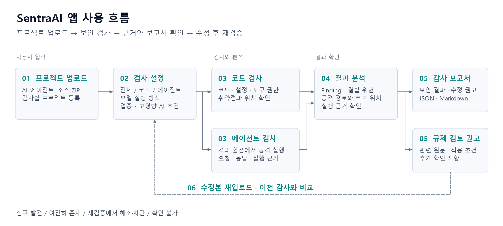
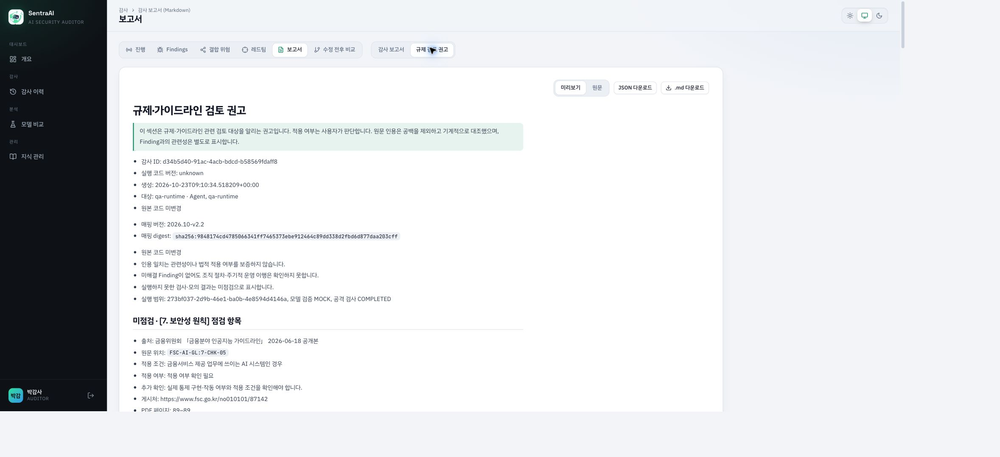
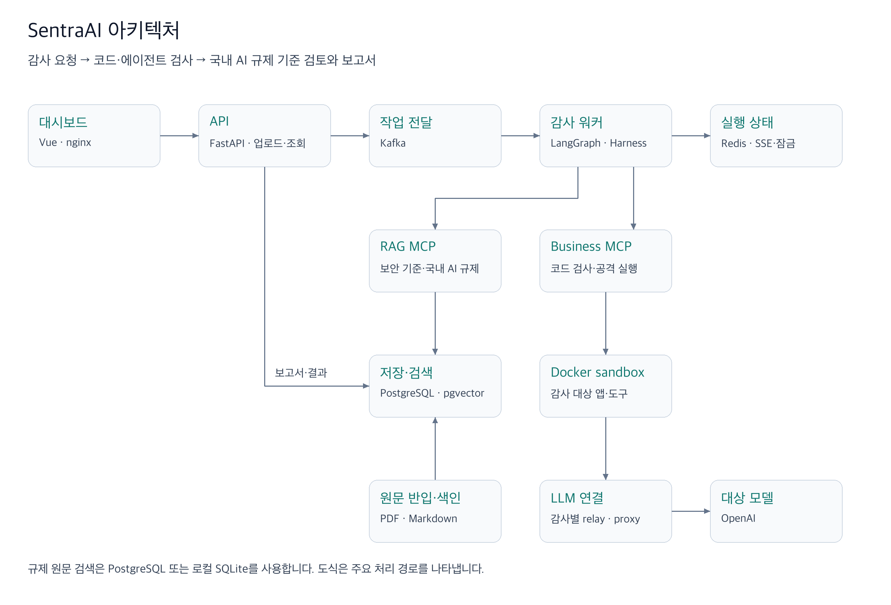
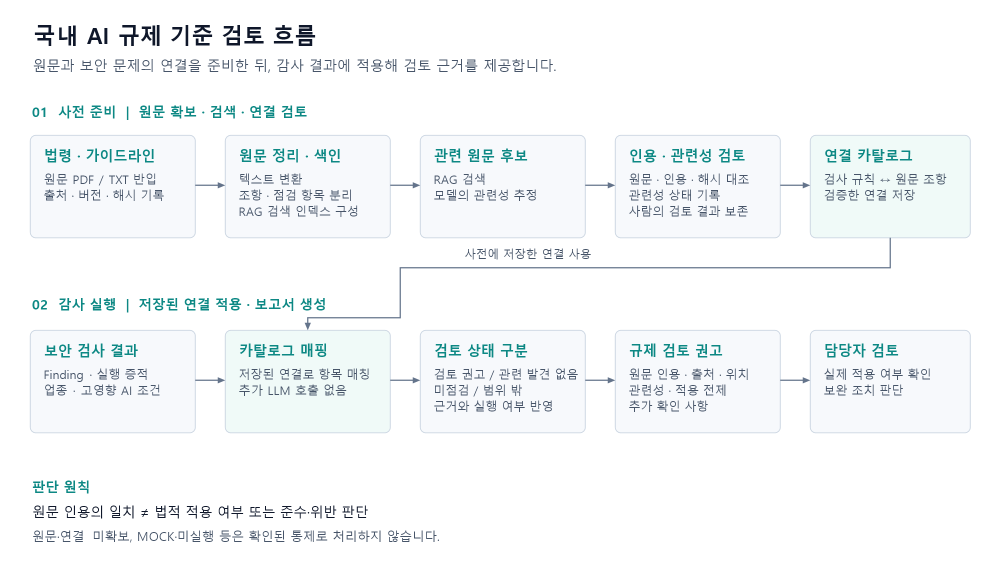
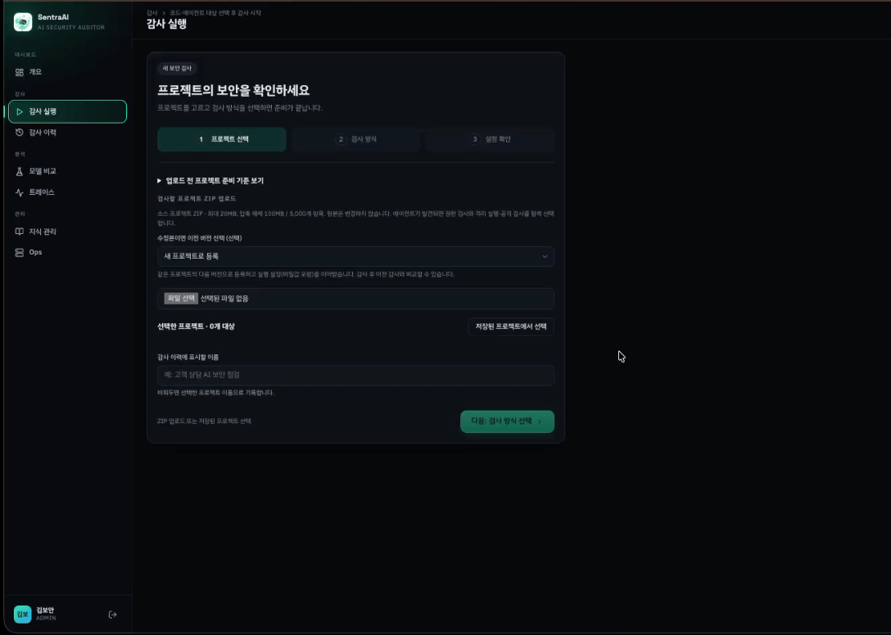
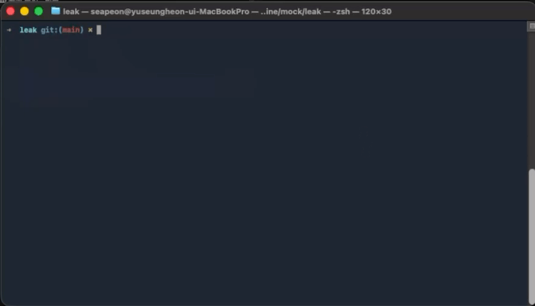

<p align="center">
  
</p>

<h1 align="center">SentraAI</h1>
<p align="center"><strong>AI 에이전트 보안 감사 · 국내 AI 규제 기준 검토</strong></p>
<p align="center">
  <a href="https://github.com/skala-pochita/SentraAI/actions/workflows/ci.yml"></a>
</p>

AI 에이전트 프로젝트를 업로드하면 코드의 취약점과 에이전트의 도구 권한을 검사하고, 격리 환경에서 공격을 실행해 결과를 확인합니다. 발견한 보안 문제는 **국내 법령·가이드라인의 관련 원문과 연결해, 추가로 검토해야 할 항목과 근거를 보고서로 제공합니다.**

예를 들어 에이전트가 공격 지시를 따라 내부 데이터에 접근했다면, 어떤 요청이 성공했고 어느 코드와 연결되는지 확인할 수 있습니다. 이어 국내 AI 규제 기준에서 검토할 통제 항목과 원문 출처를 함께 살펴봅니다.

## 팀 Pochita

<div align="center">

<table width="100%">
  <tr>
    <td align="center" width="20%">
      <a href="https://github.com/dkdlvhs"></a><br />
      <a href="https://github.com/dkdlvhs"><b>김규현</b></a><br />
      <sub>PM · Frontend</sub>
    </td>
    <td align="center" width="20%">
      <a href="https://github.com/2heunxun"></a><br />
      <a href="https://github.com/2heunxun"><b>유승헌</b></a><br />
      <sub>Backend</sub>
    </td>
    <td align="center" width="20%">
      <a href="https://github.com/cres17"></a><br />
      <a href="https://github.com/cres17"><b>문준석</b></a><br />
      <sub>Agent Flow</sub>
    </td>
    <td align="center" width="20%">
      <a href="https://github.com/nawonpp"></a><br />
      <a href="https://github.com/nawonpp"><b>박나원</b></a><br />
      <sub>RAG · Embedding</sub>
    </td>
    <td align="center" width="20%">
      <a href="https://github.com/younheejae"></a><br />
      <a href="https://github.com/younheejae"><b>윤희재</b></a><br />
      <sub>QA</sub>
    </td>
  </tr>
  <tr>
    <td valign="top" width="20%"><sub>· 일정·범위 관리<br />· 대시보드 UI<br />· 3D 시각화</sub></td>
    <td valign="top" width="20%"><sub>· API·인증·DB<br />· Kafka 작업 처리<br />· 격리 실행·CLI</sub></td>
    <td valign="top" width="20%"><sub>· LangGraph 흐름<br />· ReAct 에이전트<br />· 레드팀 공격</sub></td>
    <td valign="top" width="20%"><sub>· 원문 색인<br />· 하이브리드 검색<br />· 규제 근거 매핑</sub></td>
    <td valign="top" width="20%"><sub>· 단위·E2E 테스트<br />· 품질 비교 실험<br />· 재검증 흐름</sub></td>
  </tr>
</table>

</div>

## 앱 사용 흐름



| 단계 | 화면에서 하는 일 | 확인할 수 있는 내용 |
|---|---|---|
| 업로드·설정 | 소스 ZIP을 올리고 전체/코드/에이전트 검사, 모델 실행 방식, 업종·고영향 AI 조건 선택 | 검사 대상과 실행 준비 상태 |
| 감사 진행 | 진행 화면에서 검사 단계 확인 | 완료한 단계와 실행 오류 |
| 결과 확인 | Findings·결합 위험·레드팀 화면에서 문제 선택 | 파일·라인·코드, 공격 요청·응답, 문제들이 이어지는 경로 |
| 보고서 확인 | 보고서에서 ‘감사 보고서’ 또는 ‘규제 검토 권고’ 선택 | 보안 결과와 국내 AI 규제 기준 검토, JSON·Markdown 다운로드 |
| 수정 후 확인 | 수정본을 이전 버전과 연결해 다시 업로드 | 신규 발견·여전히 존재·재검증에서 해소 또는 차단·확인 불가 |

### 실제 보고서 화면

상단 탭에서 검사 결과를 이동하고, **감사 보고서 / 규제 검토 권고**를 전환합니다. 아래는 MOCK으로 검사한 실제 화면입니다. 실행 결과와 원문 출처를 보여주면서, 실제 모델로 확인하지 않은 통제는 **미점검**으로 표시합니다.




## 아키텍처

화면에서 요청한 감사는 Kafka를 통해 워커에 전달됩니다. 감사 에이전트는 MCP 도구로 코드를 검사하고 격리 환경을 실행하며, RAG로 보안 기준을 조회합니다. 규제 보고서는 원문 인용과 관련성을 검토해 저장한 연결을 사용합니다.



### 국내 AI 규제 기준 검토는 어떻게 동작하나요?

**기존 보안 검사 결과에 ‘국내 AI 규제 기준에서 무엇을 더 확인해야 하는가’를 붙이는 기능입니다.** 화면에서는 ‘규제 검토 권고’로 제공하며, Finding마다 관련 원문·적용 조건·추가 확인 사항을 모아 볼 수 있습니다.



원문 검색과 관련성 연결은 **사전 준비 단계**에서 수행합니다. 감사 실행 중에는 저장된 카탈로그를 사용해 보안 검사 결과를 매핑하며, 규제 매핑을 위한 추가 LLM 호출은 하지 않습니다.

| 자료 | 보고서에서 다루는 내용 |
|---|---|
| 인공지능기본법 | 관련 조문과 적용 조건 |
| 인공지능기본법 시행령 | 법률의 구체적인 적용 조건 |
| 고영향 인공지능 사업자 책무 가이드라인 | 고영향 AI에 해당하는 경우 검토할 책무 |
| 금융분야 인공지능 가이드라인 | 금융 업무에서 검토할 점검 항목 |
| 금융분야 인공지능 보안 안내서 | 보안 문제와 관련된 기술 통제 항목 |

보고서는 짧은 원문 인용, 문서명·페이지 또는 조항 위치, 발견한 문제와의 관련성, 적용 전제와 추가 확인 사항을 제공합니다. **원문 인용이 일치하는지와 법적으로 적용되는지는 구분합니다.** 최종 준수·위반 판단은 담당자의 검토가 필요합니다.

원문이 없거나 관련 근거를 찾지 못한 항목, MOCK·미실행 결과는 확인된 통제로 처리하지 않습니다. AI RMF는 확보한 보도자료만 참고하며 확인하지 못한 본문을 근거로 사용하지 않습니다.

**새 클론에는 규제 원문 5종·관련성 연결 20개·오프라인 RAG 인덱스가 포함됩니다.** 개인 원문 등록이 없는 환경은 [배포용 규제 자료](knowledge/regulation_bundle/README.md)를 자동으로 사용하므로, 별도 원문 복사나 색인 명령 없이 규제 검색과 보고서 연결을 사용할 수 있습니다. 기본 검색은 hash-v1 임베딩과 키워드 점수를 사용하는 방식이며 모델 키가 필요하지 않습니다. 법령은 명시된 시행 버전의 본칙을 포함하며 부칙·별표는 제외합니다. 자료를 갱신하거나 자체 원문을 쓰려면 [원문 반입·색인·검토 절차](workHistory/COMPLIANCE_RUNBOOK.md)를 따릅니다.

<details>
<summary>RAG에 넣은 자료가 있는데 보고서에 ‘미확보 원문’이 표시된다면</summary>

‘미확보 원문’은 보고서 생성 시 원문 등록 상태가 `AVAILABLE`이 아니었던 자료입니다. 일반 RAG에 문서가 색인되어 있는 것만으로 규제 원문 등록이 완료되지는 않습니다. 규제 검토는 원본 파일·추출 텍스트·조항과 해시를 대조한 뒤 저장된 연결을 사용합니다.

- **새 클론·설치:** 공개 배포 자료는 `knowledge/regulation_bundle`에 포함됩니다. 기존 개인 원문 등록(`MANIFEST.local.yaml`)이 있으면 해당 자료가 우선하므로, 불완전한 개인 자료는 복원·검증해야 합니다. 배포 자료가 포함되기 전 버전의 CLI·이미지는 업데이트가 필요합니다.
- **실행 경로:** 개인 자료는 저장소 Compose의 `knowledge/sources`와 `config/compliance`, CLI의 `~/.sentraai/compliance/sources`와 `~/.sentraai/compliance/config`에서 관리합니다. `COMPLIANCE_SOURCES_DIR`와 `COMPLIANCE_CONFIG_DIR`로 마운트 경로를 바꿀 수 있습니다. 빈 기본 디렉터리는 이미지 내부의 배포 자료를 가리지 않습니다. 사용자 지정 `REGULATION_INDEX_PATH`가 있으면 그 인덱스가 원문과 일치하는지 확인합니다.
- **MOCK 검사:** MOCK 때문에 표시되는 ‘미점검’과 원문 등록 누락으로 표시되는 ‘미확보 원문’은 별개입니다. 실제 모델로 바꾸는 것만으로 원문 누락이 해결되지는 않습니다.
- **기존 보고서:** 생성 당시 상태를 보존하므로 원문·연결을 복구해도 자동 갱신되지 않습니다. 복구 상태를 검증한 뒤 새 감사를 실행해 확인합니다.

</details>

## 주요 기능

| 기능 | 결과에서 확인하는 것 |
|---|---|
| 코드 보안 검사 | 비밀정보 노출, SQL Injection, 경로 탐색, Spring Security 설정 문제 등의 코드 위치와 수정 권고 |
| 에이전트 공격 검사 | 도구 권한·시스템 프롬프트를 점검하고, 인젝션 공격의 성공·차단·미확인 결과와 실행 기록 확인 |
| 공격 경로 분석 | 코드 문제와 에이전트 동작이 어떻게 이어지는지 확인. 실제 실행 근거와 조건부 추정을 구분 |
| 국내 AI 규제 기준 검토 | 발견한 보안 문제와 국내 법령·가이드라인을 연결한 검토 항목, 원문 인용, 출처와 적용 조건 |
| 수정 전후 비교 | 같은 프로젝트의 이전 감사와 비교해 남은 문제와 재검증 결과 확인 |
| 모델 비교 | 내장 정답셋으로 모델 단독과 감사 시스템의 탐지 품질·시간·토큰 사용량 비교 |

## 기술 스택

| 영역 | 사용 기술 |
|---|---|
| 백엔드 | Python 3.12, FastAPI, SQLAlchemy 2 (async), Alembic, uv |
| 에이전트 | LangGraph, LangChain, langchain-mcp-adapters, FastMCP |
| 데이터 | PostgreSQL + pgvector, Redis Stack, Kafka (KRaft), 독립 규제 검색용 SQLite |
| 프론트 | Vue 3, TypeScript, Vite, Pinia, ECharts, Three.js |
| 실행 격리 | Docker SDK (sandbox-runner) |
| LLM | OpenAI (`LLM_SMALL_MODEL`, 임베딩 `EMBEDDING_MODEL`), LangSmith (선택) |

<details>
<summary>감사 처리와 보안 설계</summary>

- LangGraph에서 코드 검사와 에이전트 검사를 수행한 뒤, 같은 대상의 근거를 연결해 공격 경로와 보고서를 생성합니다.
- ReAct 조사로 위험 파일과 보안 기준을 조회하고, 대상 도구에 맞는 추가 공격을 구성합니다. 파일·라인의 실재 여부와 공격 판정을 재확인합니다.
- Kafka 수동 커밋, Redis 잠금·체크포인트로 중복 작업과 중단에 대응합니다. 재시도 한도를 넘긴 작업은 DLQ에 보관하며 Ops 화면에서 재처리합니다. 진행 상태는 SSE로 전달합니다.
- 업로드는 경로 탈출·심볼릭 링크·ZIP bomb을 차단합니다. sandbox는 감사별 내부 네트워크, 비루트 실행, 읽기 전용 루트, 권한·자원 제한을 적용합니다.
- 모델 키는 암호화 저장소와 프록시에서 관리하고, 대상에는 감사 전용 임시 토큰을 전달합니다. 비밀값은 로그·보고서에서 마스킹합니다.
- 규제 보고서는 ADMIN/AUDITOR 권한을 확인합니다. 저장된 보고서의 SHA256으로 데이터 일관성을 검사하며 전자서명으로 취급하지 않습니다.

</details>

## 실행

```bash
cp .env.example .env      # OPENAI_API_KEY, LLM_SMALL_MODEL, JWT_SECRET 등 기입
make up                   # 전체 컨테이너 기동 (healthy 까지 대기)
make demo-reset           # 감사 대상 작업공간(/workspace) 초기화
make seed                 # 데모 계정·대상·지식 문서
open http://localhost:5173
```



`OPENAI_API_KEY`가 비어 있으면 LLM 노드를 건너뛰고 정적 규칙 결과로만 동작한다.

| 서비스 | 포트 |
|---|---|
| frontend | 5173 |
| api (OpenAPI `/docs`) | 8000 |
| business-mcp / rag-mcp | 8101 / 8102 (`/mcp`) |
| target-agent (내장 샘플 에이전트) | 8201 |
| kafka-ui (`docker compose --profile ui up -d kafka-ui`) | 8080 |

> 로컬 개발·시연용 구성이다. 외부에 공개된 네트워크에서 실행하지 말고, 실행 전 `.env`의 `JWT_SECRET`·`MCP_SERVICE_TOKEN`·시드 비밀번호를 새 값으로 바꾼다.

### sentraai CLI (저장소 없이 로컬 실행)

저장소를 받지 않아도 Node 22.13+ 와 Docker Desktop 만 있으면 된다. 로그인 없이 이 컴퓨터에서만 접근할 수 있는 로컬 모드로 뜬다.

```bash
npm install -g https://github.com/skala-pochita/SentraAI/releases/download/v0.1.0-rc.3/sentraai-0.1.0-rc.3.tgz
cd ~/my-agent-project
sentraai            # Docker 확인 → (처음만) OpenAI·LangSmith 키 입력 → 감사 확인 → 진행 → 대시보드
sentraai setup      # 키 다시 입력          sentraai stop   # 서버 멈춤 (기록 유지)
```



위 링크는 이미 공개된 프리릴리즈이며, 이후 main에 추가된 규제 기능은 새 버전 Release 전까지 저장소에서 실행한다. 배포는 `cli/package.json` 버전을 올리고 같은 이름의 태그를 push 하면 GitHub Actions가 이미지(GHCR)와 CLI(Release)를 올린다. 첫 배포 뒤 GHCR 패키지를 Public으로 바꿔야 로그인 없이 받을 수 있다. 로컬에서 이미지만 만들어 시험하려면 `make cli-images && make cli-pack`.


<details>
<summary>수정본 재업로드와 비교 API</summary>

수정본을 다시 업로드하면 같은 공격을 재실행하고, 이전 감사에서 발견한 문제가 남아 있는지 비교한다.

1. 감사 실행 화면에서 "이전 버전"을 고르고 수정본 ZIP을 올린다 → 같은 프로젝트의 다음 버전(v2…)으로 등록되고 실행 설정·비밀값을 이어받는다.
2. "수정 전후 비교"에서 기준 감사(이전 버전의 완료된 감사)를 고르고 전체 또는 에이전트 모드로 감사한다.
3. 완료 후 "수정 전후 비교" 탭에서 Finding·공격을 **신규 발견 / 여전히 존재 / 재검증에서 해소·차단 / 확인 불가**로 나눠 본다. 미실행·오류·판정 불확실·실행 모드(실제 LLM·모의) 불일치·정상 대조군 실패는 확인 불가이며 해결로 세지 않는다.

API로도 같은 흐름을 쓸 수 있다.

```bash
curl -F file=@fixed.zip -F previous_target_id=$V1_TARGET -H "Authorization: Bearer $TOKEN" $API/api/v1/targets/upload
curl -H "Authorization: Bearer $TOKEN" $API/api/v1/targets/$V2_TARGET/baselines            # 기준 감사 후보
curl -H "Authorization: Bearer $TOKEN" -H 'Content-Type: application/json' \
     -d '{"target_ids":["'$V2_TARGET'"],"mode":"full","baseline_audit_id":"'$V1_AUDIT'"}' $API/api/v1/audits
curl -H "Authorization: Bearer $TOKEN" $API/api/v1/audits/$V2_AUDIT/compare                # .md 도 가능
```

</details>

## 검증 결과

2026-10-23 기준입니다. 실제 실행 환경과 로그는 [통합·보안·배포 QA](workHistory/LAW_EVIDENCE_RELEASE_QA.md)에 정리했습니다.

| 범위 | 결과 |
|---|---|
| 백엔드 | PostgreSQL을 포함한 단위·통합 검사 265개 통과 |
| 실 LLM·인프라 | 기본 검사와 분리한 실제 LLM 공격·Kafka·SSE E2E 3개 통과 |
| 프런트·CLI | 타입 검사·전체 빌드, CLI 9개 검사 통과 |
| Docker 전체 흐름 | ZIP 업로드 → 작업 전달 → 코드·에이전트 검사 → 저장 보고서. MOCK/live 각각 완료 |
| 실제 모델 호출 | 감사 전용 프록시를 경유한 대상 모델 호출 4회 성공, LIVE_VERIFIED 확인 |
| 국내 원문 검색 | 로컬 원문 5종·403개 단위, 검색 후보 110개. SQLite·PostgreSQL 고정 질의 각 8개 통과 |
| 의존성·이미지 | 운영 의존성의 알려진 취약점 검사와 이미지 3종의 환경파일·키 패턴 검사 통과 |

[GitHub Actions](https://github.com/skala-pochita/SentraAI/actions/workflows/ci.yml)는 PR과 main/feat 브랜치에서 DB 회귀, 정적 검사, 프런트·CLI, 이미지 빌드·비밀값 검사를 실행합니다. 버전 태그의 [Release 워크플로](.github/workflows/release.yml)는 GHCR 이미지와 CLI 패키지를 게시합니다.

<details>
<summary>모델 단독과 감사 시스템의 기존 비교 실험</summary>

아래는 기존 README에 기록된 2026-10-21 내장 정답셋 실험값이다. 이번 규제 기능 QA에서 재측정한 값이나 규제 매핑 정확도를 의미하지 않는다.

같은 정답셋에서 작은 모델 단일 프롬프트(A)와 우리 서비스(B, 같은 모델 + Harness + LangGraph Agent + MCP)를 비교했다. (2026-10-21, 반복 3회)

| 지표 | A 단일 프롬프트 | **B 우리 서비스** |
|---|---|---|
| code_f1 | 0.579 ± 0.046 | **0.928 ± 0.063** |
| code_recall | 0.550 | **0.967** |
| code_precision | 0.614 | **0.893** |
| agent_recall | 0.714 | **1.0** |
| severity_accuracy | 0.427 | **0.863** |
| auditor_robustness | 0.833 | **1.0** |
| tokens | 19,802 | 85,911 |
| latency_s | 23.4 | 84.6 |

B는 A보다 탐지 품질이 크게 높고, 대신 토큰은 약 4.3배, 시간은 약 3.6배 더 든다.

</details>


샘플 대상 `targets/`의 키·비밀번호는 취약점 탐지용 가짜 값입니다.


## 문서

- [기획서](workHistory/기획서.md) · [설계 변경 기록](workHistory/DECISIONS.md)
- [업로드 프로젝트 감사](workHistory/UPLOADED_PROJECT_AUDIT.md) · [공격 경로 구현](workHistory/ATTACK_PATH_IMPLEMENTATION.md)
- [국내 AI 규제 기준 검토 설계](workHistory/COMPLIANCE_MAPPING_DESIGN.md) · [원문 준비·운영](workHistory/COMPLIANCE_RUNBOOK.md)
- [통합·보안·배포 QA](workHistory/LAW_EVIDENCE_RELEASE_QA.md)
- [ISO/IEC 25010 품질 평가](workHistory/isoReport.md) · [품질 구현·검증](workHistory/QUALITY_IMPLEMENTATION.md)
