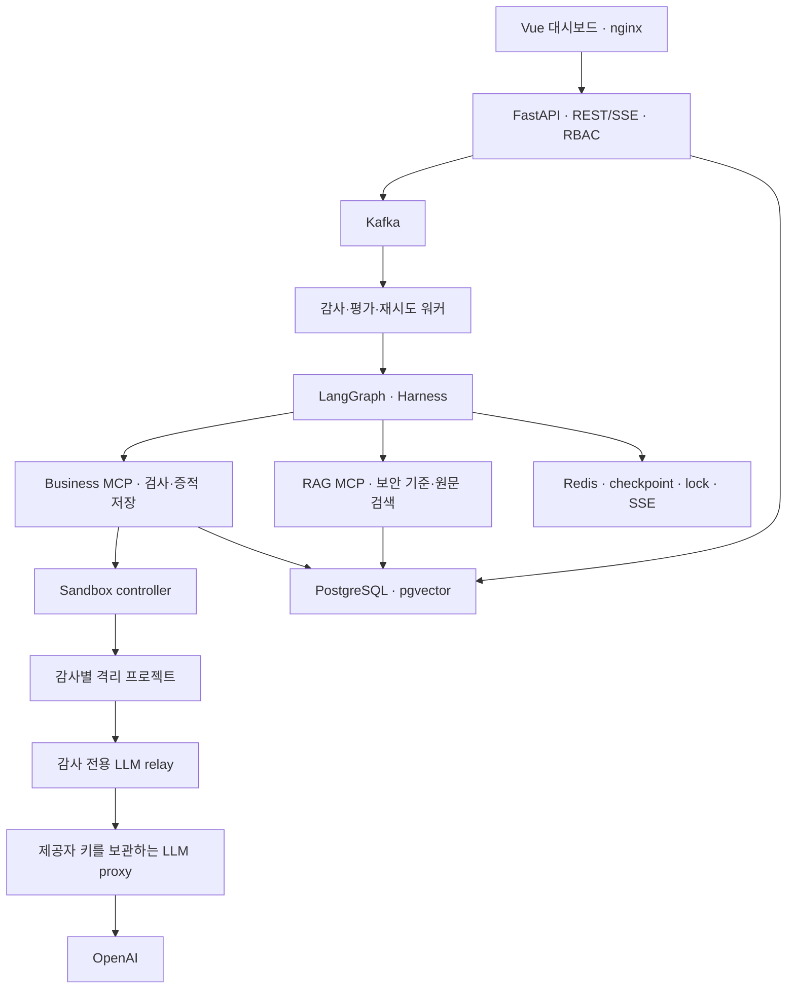
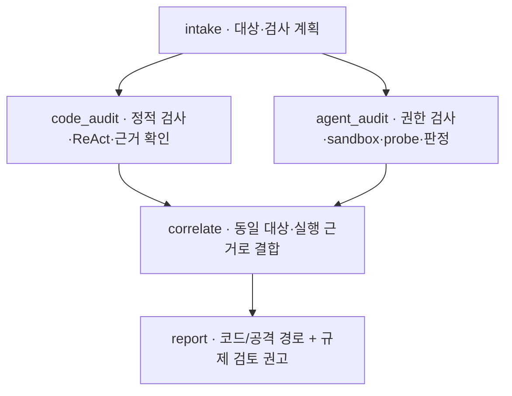

<p align="center">
  
  
</p>

# SentraAI — AI Security Auditor

[](https://github.com/skala-pochita/SentraAI/actions/workflows/ci.yml)

> AI 에이전트 프로젝트를 ZIP으로 올리면 **도구 권한·프롬프트를 점검하고, 격리된 환경에서 실제로 공격해 보고, 코드 취약점과 엮어 결합 위험까지** 근거와 함께 보고하는 읽기 전용 보안감사 에이전트.

SKALA 팀 Capstone · LangGraph / LangChain · MCP · Redis · Kafka · Vue 3

> ⚠️ `targets/` 아래 샘플 코드의 모든 키·비밀번호는 **테스트용 가짜 값**이다. 실제 서비스에서 유효하지 않다.

---

## 왜 만들었나

- 기업은 CS·사내 업무용 AI 에이전트를 빠르게 도입하지만, 에이전트가 **어떤 도구를 어떤 권한으로 호출하는지**, **프롬프트 인젝션에 뚫리는지** 점검하는 절차가 없다.
- 기존 SAST·시크릿 스캐너는 코드만 본다. 에이전트의 도구 권한·인젝션 취약성을 코드 취약점과 연결하지 못한다.
- 보안 담당자는 적고 경보는 많으며, 근거가 부족하면 개발자가 납득하지 못한다.

## 무엇을 하나

| 축 | 내용 |
|---|---|
| **Agent 검증** | 도구 정의·권한·시스템 프롬프트 정적 점검 + 격리 컨테이너에서 실제 인젝션 공격(레드팀 probe)을 실행해 방어 여부 판정 |
| **코드 검증** | 하드코딩 비밀정보, 주석 속 민감정보, Spring Security 설정 실수, SQL Injection, 경로 탐색, 로깅 노출 등 |
| **결합 위험** | 코드 결과와 Agent 결과를 연결해 심각도 재산정 (예: 인젝션 성공 + 승인 없는 삭제 도구 = CRITICAL) |
| **보고** | 파일·라인 근거, OWASP / CWE 조항, 권장 조치를 담은 보고서 (JSON + Markdown) |
| **국내 기준 검토** | 기존 Finding과 검토된 원문 연결을 대조해 짧은 인용·출처·적용 조건·추가 확인 사항을 표시. 법률 준수·위반을 자동 판정하지 않음 |

원본 코드는 바꾸지 않는다. 자동 수정·PR·병합은 하지 않는다.

- 코드 규칙 17개, Agent 정적 규칙 7개, 결합 위험 규칙 5개, 인젝션 probe 12개 + 대상 맞춤 적응형 probe
- 역할 3개(ADMIN / DEVELOPER / AUDITOR) JWT 인증 + RBAC

## 결과: 같은 작은 모델, 구조만 다르게

아래는 기존 README에 기록된 2026-10-21 내장 정답셋 실험값이다. 이번 규제 기능 QA에서 재측정한 값이나 규제 매핑 정확도를 의미하지 않는다.

같은 정답셋에서 작은 모델 단일 프롬프트(A)와 우리 서비스(B, 같은 모델 + Harness + LangGraph Agent + MCP)를 비교했다. (2026-10-21, 반복 3회)

| 지표 | A 단일 프롬프트 | **B 우리 서비스** |
|---|---|---|
| code_f1 | 0.579 ± 0.046 | **0.928 ± 0.063** |
| code_recall | 0.550 | **0.967** |
| code_precision | 0.614 | **0.893** |
| agent_recall | 0.714 | **1.0** |
| severity_accuracy | 0.427 | **0.863** |
| auditor_robustness | 0.833 | **1.0** |
| tokens | 19,802 | 85,911 |
| latency_s | 23.4 | 84.6 |

B는 A보다 탐지 품질이 크게 높고, 대신 토큰은 약 4.3배, 시간은 약 3.6배 더 든다.

---

## 아키텍처




### 감사 그래프 (LangGraph)




- **ReAct 조사**: 위험 파일을 직접 읽고 보안 기준 문서를 검색해 정적 후보를 판정하고 새 취약점을 찾는다.
- **적응형 공격**: 대상 에이전트의 도구 목록을 보고 probe를 새로 만든다.
- **자기 검증**: 근거 파일·라인 실재 확인, probe 판정 라운드 루프.

### 신뢰성
- Kafka 수동 커밋 + Redis 임대(lease) 기반 멱등 처리
- 노드 내 재시도 → `jobs.retry` 지연 재발행(5 / 30 / 120초) → 한도 초과 시 DLQ, Ops 화면에서 재처리
- Redis 체크포인트로 끊긴 노드부터 재개, MCP 서킷 브레이커
- SSE 진행 이벤트 (`Last-Event-ID` 재연결 지원)

### 보안 설계
- 감사 대상 텍스트는 지시로 취급하지 않는다 (감사기 대상 인젝션 방어)
- 비밀값은 로그·DB·보고서·LLM 출력에서 마스킹
- 업로드 ZIP: 경로 탈출·심볼릭 링크·ZIP bomb 차단, 정적 분석 단계에서 코드 실행 없음
- 격리 실행: 읽기 전용 루트, cap_drop ALL, 리소스 한도, 호스트 포트 없음, 감사별 internal 네트워크
- 업로드 대상의 모델 키는 암호화 저장소와 LLM 프록시에만 두고, 대상에는 감사 전용 임시 토큰만 전달
- 규제 섹션은 ADMIN/AUDITOR만 조회. 일반 보고서 JSON·Markdown을 통한 역할 우회도 차단
- 새 규제 보고서는 저장 JSON 해시의 누락·불일치를 거부. SHA256은 스냅샷 대조용이며 전자서명은 아님
- sandbox 정리 범위를 스택 namespace로 제한. 다른 실행 환경의 컨테이너·네트워크·이미지 보존
- 개발용 공개 포트는 127.0.0.1에 바인딩. 외부 운영 시 별도의 인증·TLS·네트워크 구성이 필요

## 기술 스택

| 영역 | 사용 기술 |
|---|---|
| 백엔드 | Python 3.12, FastAPI, SQLAlchemy 2 (async), Alembic, uv |
| 에이전트 | LangGraph, LangChain, langchain-mcp-adapters, FastMCP |
| 데이터 | PostgreSQL + pgvector, Redis Stack, Kafka (KRaft), 독립 규제 검색용 SQLite |
| 프론트 | Vue 3, TypeScript, Vite, Pinia, ECharts, Three.js |
| 실행 격리 | Docker SDK (sandbox-runner) |
| LLM | OpenAI (`LLM_SMALL_MODEL`, 임베딩 `EMBEDDING_MODEL`), LangSmith (선택) |

---

## 실행

```bash
cp .env.example .env      # OPENAI_API_KEY, LLM_SMALL_MODEL, JWT_SECRET 등 기입
make up                   # 전체 컨테이너 기동 (healthy 까지 대기)
make demo-reset           # 감사 대상 작업공간(/workspace) 초기화
make seed                 # 데모 계정·대상·지식 문서
open http://localhost:5173
```

`OPENAI_API_KEY`가 비어 있으면 LLM 노드를 건너뛰고 정적 규칙 결과로만 동작한다.

| 서비스 | 포트 |
|---|---|
| frontend | 5173 |
| api (OpenAPI `/docs`) | 8000 |
| business-mcp / rag-mcp | 8101 / 8102 (`/mcp`) |
| target-agent (내장 샘플 에이전트) | 8201 |
| kafka-ui (`docker compose --profile ui up -d kafka-ui`) | 8080 |

> 로컬 개발·시연용 구성이다. 외부에 공개된 네트워크에서 실행하지 말고, 실행 전 `.env`의 `JWT_SECRET`·`MCP_SERVICE_TOKEN`·시드 비밀번호를 새 값으로 바꾼다.

### sentraai CLI (저장소 없이 로컬 실행)

저장소를 받지 않아도 Node 22.13+ 와 Docker Desktop 만 있으면 된다. 로그인 없이 이 컴퓨터에서만 접근할 수 있는 로컬 모드로 뜬다.

```bash
npm install -g https://github.com/skala-pochita/SentraAI/releases/download/v0.1.0-rc.3/sentraai-0.1.0-rc.3.tgz
cd ~/my-agent-project
sentraai            # Docker 확인 → (처음만) OpenAI·LangSmith 키 입력 → 감사 확인 → 진행 → 대시보드
sentraai setup      # 키 다시 입력          sentraai stop   # 서버 멈춤 (기록 유지)
```

위 링크는 이미 공개된 프리릴리즈이며, 이후 main에 추가된 규제 기능은 새 버전 Release 전까지 저장소에서 실행한다. 배포는 `cli/package.json` 버전을 올리고 같은 이름의 태그를 push 하면 GitHub Actions가 이미지(GHCR)와 CLI(Release)를 올린다. 첫 배포 뒤 GHCR 패키지를 Public으로 바꿔야 로그인 없이 받을 수 있다. 로컬에서 이미지만 만들어 시험하려면 `make cli-images && make cli-pack`.

### 데모 계정 (운영 금지)

| 이메일 | 역할 | 비밀번호 |
|---|---|---|
| admin@demo.io | ADMIN | `.env`의 `SEED_ADMIN_PASSWORD` |
| dev@demo.io | DEVELOPER | `SEED_DEV_PASSWORD` |
| auditor@demo.io | AUDITOR | `SEED_AUDITOR_PASSWORD` |

### 사용 흐름
1. 감사 실행 화면에서 소스 ZIP(최대 20MiB, 해제 100MiB·5,000개 항목)을 업로드한다.
2. 에이전트 정의가 있으면 소스 + Agent 대상이 함께 등록되고, 지원되는 Compose/Dockerfile이 있으면 격리 실행과 공격 검사까지 수행한다.
3. 감사 중에는 진행 상태만 표시되고, 완료 후 문제점·근거·권장 조치와 보고서를 조회한다.
4. 모델 비교 화면에서 A / B 구성을 내장 정답셋으로 비교한다.

자세한 실행 계약은 [업로드 프로젝트 전체 감사](workHistory/UPLOADED_PROJECT_AUDIT.md)를 참고한다.

### 수정 전후 비교 (수정본 재업로드)
감사기는 원본을 고치지 않는다. 개발자가 직접 고친 수정본을 다시 올리면 같은 공격을 다시 실행해 이전 감사와 비교한다.

1. 감사 실행 화면에서 "이전 버전"을 고르고 수정본 ZIP을 올린다 → 같은 프로젝트의 다음 버전(v2…)으로 등록되고 실행 설정·비밀값을 이어받는다.
2. "수정 전후 비교"에서 기준 감사(이전 버전의 완료된 감사)를 고르고 전체 또는 에이전트 모드로 감사한다.
3. 완료 후 "수정 전후 비교" 탭에서 Finding·공격을 **신규 발견 / 여전히 존재 / 재검증에서 해소·차단 / 확인 불가**로 나눠 본다. 미실행·오류·판정 불확실·실행 모드(실제 LLM·모의) 불일치·정상 대조군 실패는 확인 불가이며 해결로 세지 않는다.

API로도 같은 흐름을 쓸 수 있다.

```bash
curl -F file=@fixed.zip -F previous_target_id=$V1_TARGET -H "Authorization: Bearer $TOKEN" $API/api/v1/targets/upload
curl -H "Authorization: Bearer $TOKEN" $API/api/v1/targets/$V2_TARGET/baselines            # 기준 감사 후보
curl -H "Authorization: Bearer $TOKEN" -H 'Content-Type: application/json' \
     -d '{"target_ids":["'$V2_TARGET'"],"mode":"full","baseline_audit_id":"'$V1_AUDIT'"}' $API/api/v1/audits
curl -H "Authorization: Bearer $TOKEN" $API/api/v1/audits/$V2_AUDIT/compare                # .md 도 가능
```

## 개발

```bash
make test    # 기본 단위·통합 테스트. DB가 없으면 DB 통합 항목은 skip하므로 QA에서는 PostgreSQL을 준비한다
make lint    # ruff + mypy + vue-tsc
cd frontend && pnpm dev   # http://localhost:5173 (api 프록시)
```

## 저장소 구조

```
backend/     api · core(graph, kafka, db) · harness · mcp_servers · workers · llm_proxy · sandbox
frontend/    Vue 3 대시보드
rules/       코드·Agent·결합 위험 규칙 (YAML)
knowledge/   보안 RAG 지식 + sources/ 원문 manifest·검토 정책 (PDF·추출물·인덱스는 로컬 전용)
datasets/    비교 실험 정답셋
targets/     내장 샘플 감사 대상 (취약 Spring 앱, CS 에이전트 vuln/hardened)
config/      모델·예산·임계값 설정
workHistory/ 기획서·설계 결정·품질 보고서 등 작업 기록
```

## 문서

- [기획서](workHistory/기획서.md)
- [설계 변경 기록](workHistory/DECISIONS.md)
- [ISO/IEC 25010 품질 평가](workHistory/isoReport.md)
- [품질 구현·검증](workHistory/QUALITY_IMPLEMENTATION.md)
- [진행 체크리스트](workHistory/checklist.md)

### 근거가 연결된 공격 경로 (2026-10-23)

결합 위험에서 단계·연결별 실행 확인/정적 근거/조건부 추정을 표시하고, 선택한 단계의 코드와 probe 실행 기록을 조회한다. 도구 동작 특성과 동일 대상·실행 시도 근거로 판단하며, 미확인 영향은 확정하지 않는다. 기존 감사는 기존 형식으로 조회되고 새 감사부터 경로 근거를 수집한다.

현재 main의 공격 경로 migration은 `0006`이며, 기준 감사 `0005`·보정 `0007`·규제 유형 `0008` 순서로 적용한다. API·MCP·워커·프론트를 함께 갱신한다. 구현 범위·규칙 변경·검증은 [공격 경로 구현 및 검증](workHistory/ATTACK_PATH_IMPLEMENTATION.md)을 참고한다.

결합 이유에는 실제 설정 줄과 구현 코드 후보의 파일·라인·코드 조각을 함께 표시한다. 심각도 산정 규칙은 유지하며, 이름이 일치하는 구현 후보와 확인된 코드 검사 결과를 구분한다.

### 규제·가이드라인 검토 권고

원문 확보 → PDF/텍스트 정규화·Markdown 변환 → 조항/점검 항목 분리 → 원문 hash·위치 대조 → RAG 후보 검색 → 관련성 검토 → 저장된 연결로 보고서를 생성한다. 런타임에 조항이나 관련성 점수를 새로 만들어 내지 않는다.

| 원문 | 취급 |
|---|---|
| 인공지능기본법·시행령 | 확보한 버전의 조문 및 적용 조건 |
| 고영향 인공지능 사업자 책무 가이드라인 | 원문 발췌와 고영향 AI 적용 전제 |
| 금융분야 인공지능 가이드라인 | 원문의 실제 점검 항목 |
| 금융분야 인공지능 보안 안내서 | 기술 통제에 해당하는 검토된 짧은 발췌 |
| AI RMF 보도자료 | 참고 자료로만 보존. 확인하지 못한 본문을 대신하는 근거로 사용하지 않음 |

- 로컬 QA 원문은 **5종·403개 단위**, 기본 검색 후보는 **110개**다. 목차·예시·미분류 페이지는 자동 근거 후보에서 제외한다.
- 인용 일치와 관련성(AI 추정/사람 확인)을 구분한다. 사람 확인·기각 이력을 보존하며, 원문이 바뀌면 재검토 대상으로 돌린다.
- 관련 근거가 없거나 평가에 실패한 Finding도 삭제하지 않고 연결 보류 사유를 표시한다.
- `MOCK`·미실행·제공자 호출 미확인 결과는 동적 통제 확인으로 인정하지 않는다. 조직 절차·주기적 훈련은 별도 운영 증적이 필요하다.
- 감사 생성 시 업종·고영향 AI 조건을 선택할 수 있다. 일반 보고서와 별도 규제 JSON/Markdown은 같은 저장 스냅샷을 사용한다.
- 실제 PDF·추출물·생성 연결·로컬 인덱스는 Git과 이미지에 포함하지 않는다. 새 장비에서는 원문을 반입하고 색인·후보 생성을 수행해야 한다.

실행: [원문 반입·색인·검토 runbook](workHistory/COMPLIANCE_RUNBOOK.md). 설계: [원문 기반 검토 계약](workHistory/COMPLIANCE_MAPPING_DESIGN.md).

## 검증과 CI/CD

2026-10-23 [PR #6](https://github.com/skala-pochita/SentraAI/pull/6)의 브랜치·병합 조합 CI 전체 통과 후 규제 기능을 main에 통합했다(`46f9c6b`). [병합 전 Actions](https://github.com/skala-pochita/SentraAI/actions/runs/39932538222)와 위 main 상태 배지에서 원격 결과를 확인할 수 있다. 최신 상세 결과·명령·실행 환경은 [최종 보안·배포 QA](workHistory/LAW_EVIDENCE_RELEASE_QA.md)에 기록한다.

| 범위 | 확인 내용 |
|---|---|
| 기본 회귀 | PostgreSQL을 포함한 단위·통합 265개 통과(건너뜀 0), CLI 9개, lint·타입 검사·프런트 전체 빌드 |
| 분리 E2E 3개 | 실제 Kafka 감사 완료·SSE 수신·실 LLM 공격 smoke 통과 |
| 실제 Docker 업로드 | API → Kafka → worker → MCP → sandbox → 저장 보고서. mock과 live를 분리 검증 |
| live 호출 증거 | 감사 전용 relay/proxy를 경유한 제공자 호출 4회 성공, 보고서 `LIVE_VERIFIED` |
| 실원문 검색 | SQLite와 PostgreSQL 각각 고정 수용 질의 8개 및 정확 인용 대조 |
| 의존성·이미지 | 백엔드/프런트 운영 의존성 알려진 취약점 검사 및 이미지 내 키/환경파일 검사 |

PR과 `main`/`feat/**` push에서 [CI](.github/workflows/ci.yml)가 DB 회귀·백엔드 정적 검사·프런트/CLI 검사·이미지 3종 빌드/비밀값 검사를 실행한다. 유료 LLM과 실제 전체 스택 검증은 별도 QA로 실행해 CI의 오프라인 검사와 구분한다.

버전 태그(`v*`)의 [release](.github/workflows/release.yml)는 버전 일치 확인 → 이미지 빌드·비밀값 검사 → GHCR → CLI Release 순서다. main merge 자체가 운영 서버 자동 배포나 새 버전 Release를 의미하지 않는다.

```bash
# 실행 중인 전용 QA 스택의 분리 E2E
cd backend
API_URL_HOST=http://127.0.0.1:58001/api/v1 TARGET_AGENT_URL_HOST=http://127.0.0.1:58202 \
  uv run pytest -m 'llm or infra' tests/e2e
```

실제 sandbox 재현은 `scripts/qa_deployed_stack.py`로 수행한다. Maven Central 접근이 제한된 환경에서는 `scripts/prepare_runtime_qa_fixture.py`가 공식 Google Maven Central 미러를 사용하는 QA 사본을 만든다. 원래 ZIP·애플리케이션·probe 코드는 보존하고 TLS 검증도 유지한다.

## 현재 한계와 운영 전제

- 검사 대상은 지원되는 ZIP/Compose·프로토콜·probe 계약으로 제한된다. 모든 언어·모델·서비스의 보안성을 보증하지 않는다.
- 원문은 확보 시점의 고정 버전이다. 법령 개정 추적, 업종·고영향 AI의 최종 적용 판단, 조항 관련성에 대한 전문가 검토가 필요하다. 현재 후보는 사람 확인 완료로 간주하지 않는다.
- hash 임베딩은 오프라인 대체 수단으로 의미 검색에 한계가 있다. 고정 질의 8개 통과는 독립적인 검색 품질/법적 정확도 벤치마크가 아니다.
- 모델의 공격 성공률은 표본·모델·프롬프트·실행 모드에 따라 달라진다. mock 결과를 실제 LLM 방어 성능으로 사용하지 않는다.
- Docker sandbox는 감사별 내부 네트워크·비루트·읽기 전용 파일시스템·자원 제한을 제공하지만 VM 수준 경계는 아니다. Docker 소켓을 가진 controller는 신뢰되는 실행 서버에서 운영해야 한다.
- 대상 빌드에 필요한 패키지 저장소 접근과 기동 시간이 필요하다. 준비 실패는 미점검으로 기록하고, 실행하지 않은 공격을 통과·해소로 표시하지 않는다.
- 프런트 빌드는 통과하지만 ECharts·Three.js의 일부 청크가 500kB를 넘는 경고가 남는다. 실제 전송량·초기 로딩 측정 후 추가 분할을 검토한다.
- 원문·검토 파일·DB·암호화 vault의 데이터와 master key는 각각 접근 제어·백업·복구 절차를 마련해야 한다. 로컬 기본 구성을 그대로 외부에 공개하지 않는다.
