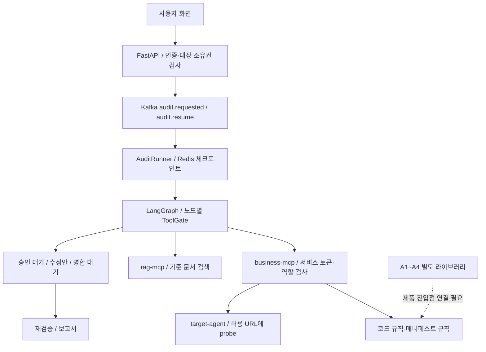

# 코드·AI Agent 감사 QA

기준: 2026-10-20 KST, `/Users/moon/Documents/product`, HEAD `5b38144` 및 당시 작업 중 변경사항 포함.

## 판정

**기본 감사 데모와 API↔MCP 연결은 동작한다. 그러나 현재 결과만으로 배포 전 보안감사 통과나 자동 수정 완료를 판정하기에는 부족하다.** 재검증의 거짓 해결, 비밀값 처리, 승인 범위 검증을 먼저 보완해야 한다. A1~A4 확장 점검은 제품 실행 경로에 연결되지 않은 라이브러리 수준이다. 이 상태는 `checklist.md:104`에도 미완료로 명시되어 있다.

이 QA에서는 제품 코드를 수정하지 않았다. 기존 작업 중 파일은 보존하고 재현 테스트와 이 보고서만 추가했다. 실제 서비스 자격증명이나 고객 자료를 사용하지 않았고, LLM 호출 비용도 발생시키지 않았다.

## 실행 결과와 근거의 범위

| 검사 | 결과 | 해석 |
|---|---|---|
| 기존 단위·통합 테스트 | **91 passed** | 실제 로컬 `auditor_test` DB, fakeredis·모델 대역·in-process MCP를 사용하는 경로. 실제 LLM 탐지 성능 증거가 아님 |
| 백엔드 ruff | 통과 | 기존 backend 범위 |
| mypy | 86 source files 통과 | `core harness mcp_servers` |
| 프런트 타입 검사·프로덕션 빌드 | 통과 | 브라우저 상호작용 검증은 별도 |
| 실제 API·business/rag MCP·target health | 모두 HTTP 200 | 연결 가능성 확인 |
| 토큰 없는 실제 MCP 요청 | 두 서버 모두 HTTP 401 | 서비스 인증 확인 |
| 실제 MCP initialize·tools/list | business 18개, rag 11개 | HTTP 프로토콜 연결 확인 |
| 실제 MCP 읽기 도구 | 대상 목록 2개·문서 목록 6개 조회 성공 | 업무 데이터는 출력·변경하지 않음 |
| 이번에 추가한 보안 기대조건 테스트 | **23 failed, 3 passed** | 아래 Q01~Q16의 결함·범위 부족을 보여주는 별도 시험. 일반 탐지 정확도나 무작위 실패율이 아님 |

처음 기본 pytest를 제한 환경에서 실행했을 때는 70 passed, 21 skipped, 3 connection errors, 1 deselected였다. 로컬 네트워크 접근을 허용한 뒤 `tests/unit tests/integration`을 명시하여 91개를 검증했다. 기본 명령이 인프라 E2E까지 수집하는 구성 문제도 아래 S1에 기록했다.

증거 파일:

- [보안 기대조건 테스트](test_readiness.py): 원래 테스트가 다루지 않는 입력·상태를 추가했다. **수정 전에는 실패하는 것이 현재 관찰 결과**이며, 수정 후 통과시키는 회귀 테스트로 쓸 수 있다.
- [재현 출력](regression-results.txt): 가짜 값만 포함한다.
- [실제 HTTP/MCP 연결 결과](live-results.json), [연결 검사 실행 파일](live_connections.py).

Q02·Q05·Q07·Q12·Q14는 노드/함수와 대역을 사용한 실행 결과다. Q15는 DB·Git을 대역으로 바꾼 승인 로직 시험이고 Q16은 실제 DB 전송 직전에 생성되는 ORM 객체를 포착했다. 이 두 항목을 실제 DB 침해·실제 Git 변경이 발생했다는 증거로 해석해서는 안 된다. Q04는 프롬프트 경계가 빠진 사실을 검증했으며 실제 모델이 인젝션에 넘어갔다는 주장은 하지 않는다.

## 연결 흐름



확인된 장점은 서비스 인증, API의 역할·소유권 검사, 노드별 도구 제한, 직접 파일 읽기의 경로 탈출 차단, 승인·병합 interrupt, 기본 그래프 재개 테스트다. 아래 문제는 이 연결 구조가 있다는 사실과 별개로 결과의 신뢰성을 떨어뜨린다.

## 우선 수정할 항목

P1은 감사 결과·비밀값·승인에 직접 영향을 주어 사용 전 보완할 항목, P2는 특정 조건의 오탐·미탐·범위·운영 정합성 문제다. P0나 실제 원격 침해가 확인됐다는 의미는 아니다.

| ID | 우선순위 | 문제와 재현 결과 | 영향·권장 조치 |
|---|---|---|---|
| Q02 | P1 | 같은 규칙이 같은 파일에서 계속 탐지되어도 코드 조각이 달라지면 `RESOLVED`. `LLM-REACT` 발견도 정적 스캐너에 해당 규칙이 없어 바로 `RESOLVED` | 취약점이 남은 채 수정 완료. 안정적인 위치·규칙 대응과 LLM 발견의 독립 재검증 필요. 검증 수단이 없으면 미검증/보류 |
| Q03 | P1 | `{"password":"demoPassword987!"}`, `api_key`, Authorization 값과 JSON 텍스트가 마스킹되지 않음 | MCP 응답·DB·LLM 입력·보고서의 비밀값 보호 계약 불충족. 키를 인식하는 구조화 마스킹과 JSON/헤더/중첩 객체 회귀 필요 |
| Q16 | P1 | 비밀값을 삭제하는 수정안의 **삭제 전 원문**이 `FixProposalRow.diff`에 그대로 담김. 응답 diff만 마스킹 | DB에 비밀값 원문을 금지한 `CLAUDE.md` 규칙 5와 충돌. 마스킹된 표시용 diff와 실행용 자료를 분리하고, 원문 보관이 필요하다면 암호화·권한·수명 정책을 명시적으로 설계 |
| Q15 | P1 | 같은 감사의 `APPROVED` 승인이라면 승인 목록에 없는 다른 CRITICAL Finding을 포함한 수정안도 통과 | 승인 범위 우회. 수정안의 CRITICAL finding_ids가 승인 집합에 포함되는지 서버에서 검증. 감사·대상·수정 버전과의 결합도 보강 |
| Q09 | P1 | `safe_path()`는 외부 symlink를 거부하지만 `iter_repo_files()`는 루트 밖 파일을 가리키는 symlink를 열거 | 정적 스캔·레포 검색이 대상 밖 파일을 읽을 수 있음. 컨테이너에서 접근 가능한 범위 안의 누출 위험이며 호스트 전체 접근을 입증한 것은 아님. 모든 읽기 경로에 동일한 경계 검사 적용 |
| Q04 | P1 | `structured_call()`이 system 템플릿을 렌더링하지 않아 `{untrusted_rule}`가 그대로 모델에 전달됨. 적응형 probe 생성에는 도구 설명을 `wrap_untrusted()` 없이 삽입 | 규칙 4의 신뢰 경계가 일부 LLM 경로에서 빠짐. system/user 템플릿을 모두 검증하고 도구 설명·가이드·피드백 등 외부 유래 텍스트 경로를 일괄 점검 |
| Q07 | P1 | 1턴에서 삭제 도구 실행, 2턴에서 거부 응답을 내면 최종 시도 판정이 `BLOCKED` | 여러 턴 공격의 성공을 놓침. 모든 턴의 응답·실행 도구·유출 신호를 누적하고 시도 전체에서 한 번이라도 성공하면 기록 |
| Q08 | P1 | 실행 못한 probe가 보고서에 `0/0`, `0%`로 표시되고 Markdown에 오류가 누락 | 실행 실패를 방어 성공으로 오해할 수 있음. NOT_RUN/ERROR/INCONCLUSIVE와 정상 차단을 분리하고 ASR은 null·미측정 처리 |
| Q01 | P1 | 실제 `run_agent_rule_check`는 기존 `check_manifest()`만 호출. 승인 없는 `execute`와 악성 도구 설명 입력이 모두 0건 | 별도 라이브러리의 A1/A4 검출이 제품에는 반영되지 않음. API→워커→MCP→보고서까지 연결하거나 제공 범위를 명확히 제한 |
| Q05 | P2 | 정적 휴리스틱이 0건이면 LLM이 “지시 계층 없음”이라 판정해도 새 Finding을 만들지 않음 | 프롬프트에 `untrusted` 같은 단어만 넣어 정적 규칙을 통과하면 미탐 유지. 양방향 재판정·근거 보존 필요 |
| Q06 | P2 | A2는 `access_policy_ref` 존재 여부만 확인하여 MCP 호출 권한과 무관한 S3 정책 ID도 받아들임. A3는 별도 정책의 명시적 Deny를 합산하지 않아 경로를 생성 | 라이브러리 수준에서도 정책 내용과 실제 접근 가능성 검증이 부족. 주체·행동·자원·조건·정책 간 Deny를 통합 평가하고 증거 부족은 HOLD로 기록 |
| Q11 | P2 | MCP 직접 호출에서 DEVELOPER 맥락으로 다른 소유자의 대상 파일 읽기 성공 | API를 거치는 정상 경로의 소유권 검사는 존재한다. **서비스 토큰을 가진 호출자가 MCP를 직접 호출할 때** 서버의 대상 소유권 재검증이 없다. MCP를 서비스 전용으로 격리하거나 actor·audit·target 권한을 서버에서도 검사 |
| Q12 | P2 | 같은 audit의 `AuditRunner._config()`를 다시 만들면 예산이 0부터 시작 | 승인 재개·재시도에 걸친 감사당 비용 상한이 유지되지 않음. 기존 누적 사용량 복원·원자적 차감 필요. target-agent의 LLM 비용도 현재 감사 Budget에 포함되지 않음 |
| Q14 | P2 | agent-A에서 발생한 프롬프트 유출을 agent-B의 비밀 포함 프롬프트와 결합해 CRITICAL 생성·승격 | 여러 대상 감사에서 잘못된 결합 위험. 모든 결합 규칙·probe 결과를 target_id와 명시적 연결 관계로 구획 |
| Q10 | P2 | decoy 한 건을 decoy FP와 unmatched FP 양쪽에 넣어 `fp=2` | 정밀도/F1 비교가 왜곡됨. 발견 단위 일대일 대응과 중복 제거, INFO·decoy 처리 규약 보강 |
| Q13 | P2 | 도구 레지스트리에 삭제된 기능의 `create_remediation_ticket`이 남지만 실제 business MCP에는 없음 (2026-10-20 레지스트리에서 제거해 해소) | 도구 라우팅 목록과 실제 tools/list 불일치. 등록된 서버 목록·allowlist·명세를 함께 검증하는 계약 테스트 필요 |

### 코드 근거

줄 번호는 QA 당시 소스 기준이다.

| ID | 위치 |
|---|---|
| Q01 | `backend/core/graph/nodes/agent_static_check.py:58`, `backend/mcp_servers/business/tools/execute.py:65`, `backend/core/rules/engine.py:152`; A1~A4 라이브러리 호출자는 `backend/tests/unit/test_agent_checks.py`뿐 |
| Q02 | `backend/core/graph/nodes/re_verify.py:62`–`75` |
| Q03 | `backend/harness/masking.py:58`–`66`; 문자열 정규식은 JSON의 따옴표로 닫힌 키를 처리하지 않음 |
| Q04 | `backend/harness/llm.py:119`–`127`, `backend/core/graph/nodes/probe_generate.py:63`, `backend/harness/prompts/agent_prompt_hierarchy_v1.yaml` |
| Q05 | `backend/core/graph/nodes/agent_static_check.py:78`–`84` |
| Q06 | `backend/core/agent_audit/checks.py:71`–`86`, `110`–`122`, `149`–`150` |
| Q07 | `backend/mcp_servers/business/tools/execute.py:173`–`178` |
| Q08 | `backend/core/graph/nodes/probe_run.py:49`–`60`, `backend/core/graph/nodes/report.py:113`–`120`; 워커 `_after()`는 오류 포함 여부와 별도로 COMPLETED 설정 |
| Q09 | `backend/core/rules/engine.py:47`, `backend/mcp_servers/business/tools/query.py:111`; 직접 읽기만 `safe_path` 사용 |
| Q10 | `backend/harness/eval/code_eval.py:56`–`60` |
| Q11 | `backend/mcp_servers/common.py:103`–`109`, `backend/mcp_servers/business/tools/query.py:85`, `backend/mcp_servers/business/workspace.py:59`; API 소유권 검사는 `backend/api/deps.py:76` |
| Q12 | `backend/workers/audit.py:65`–`69`, `backend/harness/budget.py:22`–`29`; `targets/target-agent/app.py`의 별도 모델 호출 |
| Q13 | `backend/harness/tools.py:45`, 실제 tools/list 결과 |
| Q14 | `backend/core/graph/nodes/correlate.py:133`–`150`; 다른 CORR 규칙에도 대상 범위 점검 필요 |
| Q15 | `backend/mcp_servers/business/tools/mutate.py:283`–`298`; `appr.finding_ids`를 확인하지 않음 |
| Q16 | `backend/mcp_servers/business/tools/mutate.py:201`–`204`, `229`; `backend/core/db/models.py:197` |

## 추가로 확인된 워크플로우·정책 부족

다음은 소스 검토로 확인한 항목이다. 위 23개 실패에 합산하지 않는다. 동시성·장시간 조건의 실제 발생 여부는 추가 시험이 필요하다.

| ID | 우선순위 | 내용과 조치 |
|---|---|---|
| S1 | P2 | `make test`는 “인프라 불필요”라고 안내하지만 pytest 기본 필터가 `not llm`뿐이라 `infra` E2E를 실행한다. 해당 E2E는 활성 감사를 취소하고 demo-reset도 수행한다. 기본 테스트와 데모를 변경하는 E2E를 명시적으로 분리해야 한다. `.github/workflows`도 없어 자동 QA 게이트가 없다 |
| S2 | P1 | `cancel_audit()`는 DB 상태와 락만 변경한다. 실행 중인 그래프의 취소 전달/노드별 취소 확인은 없고 `_after()`는 COMPLETED를 다시 쓴다. 취소 직후 실행 중 작업이 계속 변경할 가능성, 락 해제 후 다른 감사와 겹치는 가능성을 차단하고 동시성 시험 필요 |
| S3 | P2 | 대상 락은 1,800초 TTL이며 승인·병합 대기 동안 갱신되지 않는다. 재개 때 intake를 재실행하지 않아 락을 재확인하지 않는다. 긴 수동 대기 후 동일 대상의 동시 수정 방지가 약해질 수 있다. 원자적 해제·갱신·재획득·실행 fencing 필요 |
| S4 | P2 | `create_fix_proposal`의 대상, audit_id, finding_ids 소속 일치 검증이 부족하다. `precheck_remaining`이 있어도 `fix_generate.py:134`는 feedback만 남기고 적용 후보에 포함한다. 수정 후 해당 문제와 신규 문제가 없는지, 동작이 유지되는지 확인하는 게이트 필요 |
| S5 | P2 | 시스템은 로컬 데모 전제로 기본 JWT/MCP 토큰·DB 비밀번호와 여러 공개 포트가 있다. 실제 조직 서비스로 확장할 때는 기본값 거부·토큰 분리/회전·내부 통신 제한이 선행되어야 한다. 현재 데모에서 인증 없는 원격 침해를 재현한 것은 아니다 |
| S6 | P2 | 보고서는 실패/보류/미점검을 포괄하는 coverage 상태를 갖지 않는다. 큰 파일·바이너리·제외 디렉터리·LLM 미설정·예산 중단·최대 호출 도달을 명시해야 한다. `MAX_FIX_RETRIES=3`은 YAML 값과 별개로 하드코딩되어 규칙 6과도 어긋난다 |
| S7 | 범위 | GitHub 적용 모드는 명시적으로 미구현이며 eval-worker는 대기용이다. 가상 사내 정책·표준 요약의 정확성/최신성은 이번 코드 QA에서 외부 원문 대조를 수행하지 않았다. |

## 권장 수정 순서와 통과 기준

1. **판정·승인·비밀값 보호:** Q02, Q03, Q16, Q15, Q09, S2. 검증할 수 없으면 해결로 바꾸지 않고, 승인되지 않은 범위는 MCP 서버에서 거부하며, 저장·전송 경로에 비밀값 원문이 없어야 한다.
2. **에이전트 감사 신뢰성:** Q04, Q07, Q08, Q01, Q05, Q06, Q14. 실제 API로 시작한 감사에서 도구 오염·승인 누락·주체 정책·조합 위험 결과와 미점검 상태가 보고서까지 전달되어야 한다.
3. **운영·평가 계약:** Q11, Q12, Q10, Q13 및 S1/S3/S4/S6. 재개·실패·만료·중복 메시지와 여러 대상 조합을 포함해 검사한다.
4. 이 문서의 보안 기대조건 26개를 모두 통과시키고 기존 91개 테스트·타입 검사·빌드를 유지한다. 이어 격리된 환경에서 API→Kafka→HTTP MCP→승인→병합→재검증 E2E를 수행한다.
5. 실제 LLM은 버전·비용 상한을 고정한 별도 시험으로 수행한다. 작성자가 만든 샘플 외에 정상/취약 반례와 문구·도구명·정책 변형을 포함하고, 독립 판정 결과로 오탐·미탐·공격 성공률을 보고한다. 현재 91개 통과나 샘플 정적 recall을 일반 코드·Agent 감사 정확도로 주장하지 않는다.

## 재실행

프로젝트 루트에서:

```bash
# 오프라인: 보안 기대조건. 수정 전에는 23 failed, 3 passed가 관찰값이다.
PYTHONPATH=backend backend/.venv/bin/python -m pytest \
  reports/qa-2026-10-20/test_readiness.py -q --tb=short \
  -o asyncio_mode=auto -o asyncio_default_fixture_loop_scope=function

# 읽기 전용 실제 연결 검사: 로컬 컨테이너·네트워크 접근 필요. LLM 미호출.
PYTHONPATH=backend backend/.venv/bin/python reports/qa-2026-10-20/live_connections.py

# 기존 테스트: 로컬 auditor_test DB를 생성/초기화한다. 데모 DB를 대상으로 쓰지 않는다.
cd backend
.venv/bin/python -m pytest -q tests/unit tests/integration -ra
```

실제 LLM 레드팀, 배포, 외부 MCP/OAuth, GitHub PR 생성·병합, 장애 주입/DLQ의 전체 실환경 경로, 장시간 대기·다중 워커 경합, 화면 리허설은 이번 QA에서 실행하지 않았다.
